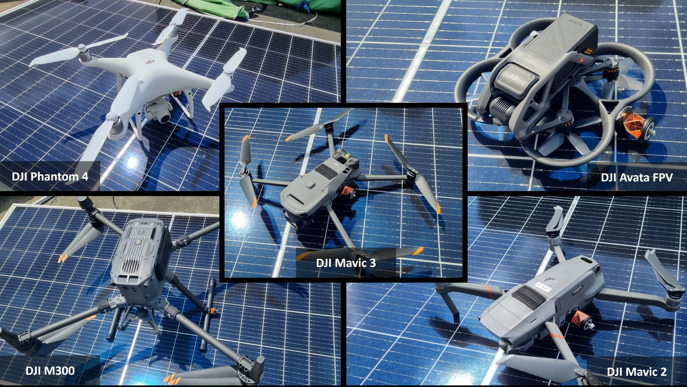
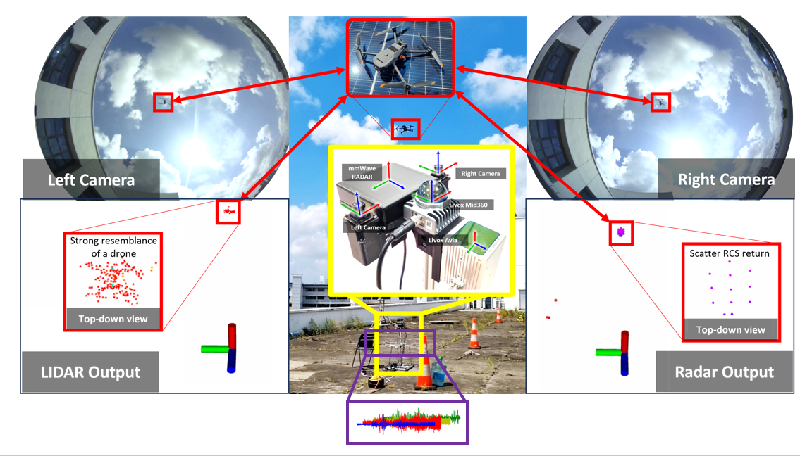
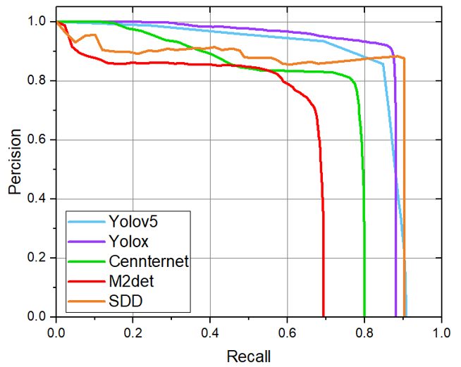
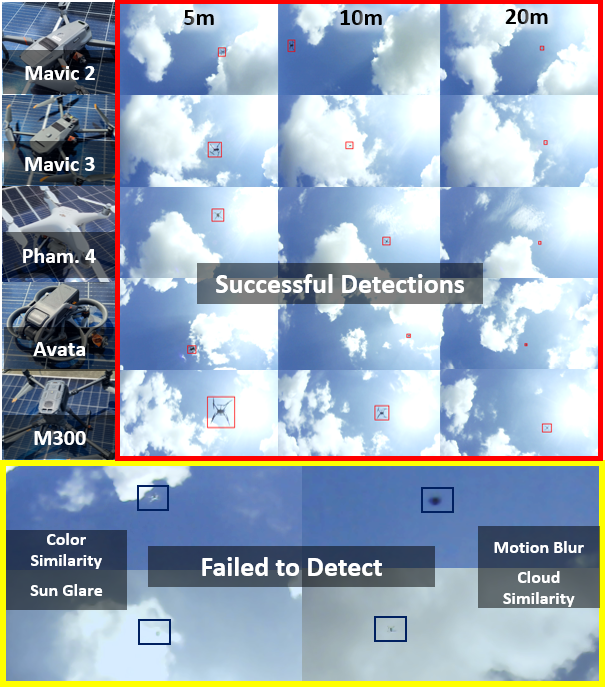

<p align="center">
    
</p>

# [MMAUD: A Comprehensive Multi-Modal Anti-UAV Dataset for Detection, Classification, Tracking and Trajectory Estimation of Compact Commercially Available Drones Threats](https://ntu-aris.github.io/MMAUD/)


This site presents the datasets collected from our research platform, featuring an extensive set of sensors:

* Two 3D lidars ( Conic LIDAR and Peripheral LIDAR)
* Two time-synchronized cameras
* One mmWave Radar
* Four Audio Array Nodes 

# Citation
If you use some resource from this data suite, please cite it as

```
@INPROCEEDINGS{yuan2024MMAUD,
  author={Yuan, Shenghai and Yang, Yizhuo and Nguyen, Thien Hoang and Nguyen, Thien-Minh and Yang, Jianfei and Liu, Fen and Li, Jianping and Wang, Han and Xie, Lihua},
  booktitle={2024 IEEE International Conference on Robotics and Automation (ICRA)}, 
  title={MMAUD: A Comprehensive Multi-Modal Anti-UAV Dataset for Modern Miniature Drone Threats}, 
  year={2024},
  pages={2745-2751},
  doi={10.1109/ICRA57147.2024.10610957}
}
```

# Downloads

**📦 For the latest complete MMAUD dataset, please visit [Hugging Face](https://huggingface.co/datasets/Yuan-Shenghai/MMAUD).**

## 🔊 Extracted background noise

**6,588 original NumPy files · 12 groups · 5.057 GB.** The extracted background-noise collection is available on [Hugging Face](https://huggingface.co/datasets/Yuan-Shenghai/MMAUD/tree/main/background_noise/np_data_align), with the original `np_data_align` folders and filenames. Nonempty files contain `float32` arrays of shape `(48000, 4)`; 4 empty source arrays are preserved.

[Format and loading examples](https://github.com/ntu-aris/MMAUD/blob/gh-pages/background_noise/README.md) · [SHA-256 checksums](https://huggingface.co/datasets/Yuan-Shenghai/MMAUD/resolve/main/background_noise/SHA256SUMS.txt) · [Original Google Drive folder](https://drive.google.com/drive/folders/1b0CzLFp_F1DHpxiAB3TYNQZiaF3KLfTd)

<!--
Note: The files below are hosted on [NTU Data Repository](https://researchdata.ntu.edu.sg/dataset.xhtml?persistentId=doi:10.21979/N9/X39LEK).
If you experience interruption from the NTU Data Repository, please try downloading the files from this [Onedrive folder](https://entuedu-my.sharepoint.com/:f:/g/personal/shyuan_staff_main_ntu_edu_sg/EvyxXbi1l5tHonBWIQxueBoByr1-E-w7fgRyHNTsCmwFcg).

Ground truth is included in the separate bag. Do check out [this example](https://github.com/brytsknguyen/VINS-Mono/blob/392c8c5732d31445b266b9ca2e2f38a5a4d82d55/vins_estimator/launch/run_one_bag_ntuviral.sh#L68) on how to extract the data into the csv format.
-->

The files below are hosted on OneDrive. If you are having a problem downloading from one drive, do raise an issue. 
 
Note: All rosbag data has been compressed using 'rosbag compress' to reduce its size by a factor of 3. If you directly run 'rosbag play,' the playback frequency will be reduced. To restore the bag to its full rate, please use the 'rosbag decompress' command.


<a name="tab-download"></a>
<style type="text/css">
.tg  {border-collapse:collapse;border-spacing:0;}
.tg td{border-color:black;border-style:solid;border-width:1px;font-family:Arial, sans-serif;font-size:14px;
  overflow:hidden;padding:10px 5px;word-break:normal;}
.tg th{border-color:black;border-style:solid;border-width:1px;font-family:Arial, sans-serif;font-size:14px;
  font-weight:normal;overflow:hidden;padding:10px 5px;word-break:normal;}
.tg .tg-6ibf{border-color:inherit;font-size:18px;text-align:center;vertical-align:top}
.tg .tg-v8dz{border-color:inherit;font-size:18px;text-align:left;vertical-align:top}
.tg .tg-9m02{border-color:inherit;color:#00E;font-size:18px;text-align:center;text-decoration:underline;vertical-align:top}
</style>
<table class="tg">
<thead>
  <tr>
    <th class="tg-6ibf">Name</th>
    <th class="tg-6ibf">ROSBag Data</th>
    <th class="tg-6ibf">Folder Data</th>
    <th class="tg-6ibf">Ground truth</th>
    <th class="tg-6ibf">Size</th>
    <th class="tg-6ibf">Duration</th>
    <th class="tg-6ibf">Remark</th>
  </tr>
</thead>
<tbody>
  <tr>
    <td class="tg-v8dz">DJI Mavic2</td>
    <td class="tg-6ibf"><a href="https://entuedu-my.sharepoint.com/:u:/g/personal/shyuan_staff_main_ntu_edu_sg/Eb-_jzBSOhpNquYUpcZZeyEB4jf-35RJEkUYMZVj80WMiw?e=FBn0q9" target="_blank" rel="noopener noreferrer">.bag</a></td>
    <td class="tg-9m02"><a href="https://entuedu-my.sharepoint.com/:u:/g/personal/shyuan_staff_main_ntu_edu_sg/ESfINWq7uCpKkjH3YhEGZ24BmyKhcgFfF09dTZYte-C-0g?e=mww8va" target="_blank" rel="noopener noreferrer">.zip</a></td>
    <td class="tg-6ibf"><a href="https://entuedu-my.sharepoint.com/:u:/g/personal/shyuan_staff_main_ntu_edu_sg/EW4eZm1eEm9FndMN8hxQyesBNdQny6iV_n86Jtwcysi7Lw?e=s8csWh" target="_blank" rel="noopener noreferrer">.bag</a></td>
    <td class="tg-6ibf">14.1 GB</td>
    <td class="tg-6ibf">198s</td>
    <td class="tg-v8dz">MMAUD V1 Rooftop Simple </td>
  </tr>
  <tr>
    <td class="tg-v8dz">DJI Mavic3</td>
    <td class="tg-9m02"><a href="https://entuedu-my.sharepoint.com/:u:/g/personal/shyuan_staff_main_ntu_edu_sg/EVqEQlvzM25Lm_q-W6G1wIsBrJWBj2O6mfLbLZ_SCkbb_w?e=EIWBxX" target="_blank" rel="noopener noreferrer">.bag</a></td>
    <td class="tg-9m02"><a href="https://entuedu-my.sharepoint.com/:u:/g/personal/shyuan_staff_main_ntu_edu_sg/ETe4YTM-IKdMnA11Q1Dv_PgBWGfQ38iwYoFpkFWthhfJsQ?e=CJU8JN" target="_blank" rel="noopener noreferrer">.zip</a></td>
    <td class="tg-6ibf"><a href="https://entuedu-my.sharepoint.com/:u:/g/personal/shyuan_staff_main_ntu_edu_sg/Eaol9EuQTZ5BmYffvBSo3kIB0DwKDcYstGvwg-Qrtnts4A?e=ZaJpsa" target="_blank" rel="noopener noreferrer">.bag</a></td>
    <td class="tg-6ibf">11.1 GB</td>
    <td class="tg-6ibf">321.1 s</td>
    <td class="tg-v8dz">MMAUD V1 Rooftop Simple</td>
  </tr>
  <tr>
    <td class="tg-v8dz">DJI Phantom4</td>
    <td class="tg-9m02"><a href="https://entuedu-my.sharepoint.com/:u:/g/personal/shyuan_staff_main_ntu_edu_sg/EUvtDQtIou5Otv4S1kFZ4ikBPCypxqpYSZ8onr5BCPpG8w?e=hlbBBz" target="_blank" rel="noopener noreferrer">.bag</a></td>
    <td class="tg-9m02"><a href="https://entuedu-my.sharepoint.com/:u:/g/personal/shyuan_staff_main_ntu_edu_sg/ERY9v7zK3hxLtxqHKVa8aDgBDSji1W_1LFeYiXN9FKJMnA?e=sTaDCI" target="_blank" rel="noopener noreferrer">.zip</a></td>
    <td class="tg-6ibf"><a href="https://entuedu-my.sharepoint.com/:u:/g/personal/shyuan_staff_main_ntu_edu_sg/EYlHSi2RmehBoPYDXiKspL0BsYx0IDXFtmG_UcFRl_AKBQ?e=B7KLP3" target="_blank" rel="noopener noreferrer">.bag</a></td>
    <td class="tg-6ibf">13.2 GB</td>
    <td class="tg-6ibf">181.4 s</td>
    <td class="tg-v8dz">MMAUD V1 Rooftop Simple</td>
  </tr>
  <tr>
    <td class="tg-v8dz">DJI Avata</td>
    <td class="tg-9m02"><a href="https://entuedu-my.sharepoint.com/:u:/g/personal/shyuan_staff_main_ntu_edu_sg/ETqBudcomxlMn_ClHROwLLAB_5XP5t_elNcU2B7siU-1RQ?e=bYrzOi" target="_blank" rel="noopener noreferrer">.bag</a></td>
    <td class="tg-9m02"><a href="https://entuedu-my.sharepoint.com/:u:/g/personal/shyuan_staff_main_ntu_edu_sg/EU-kJE4eYctGkb6VOif4JEwBwSRjUpcWjFaDc4D-v-mUrA?e=Uxpq5y" target="_blank" rel="noopener noreferrer">.zip</a></td>
    <td class="tg-6ibf"><a href="https://entuedu-my.sharepoint.com/:u:/g/personal/shyuan_staff_main_ntu_edu_sg/EYoZq-lAmvVMgncDhDX4MDIBy6_mqqobYE1WW8xQ7EhfxQ?e=QJqwJc" target="_blank" rel="noopener noreferrer">.bag</a></td>
    <td class="tg-6ibf">19.7 GB</td>
    <td class="tg-6ibf">396.3 s</td>
    <td class="tg-v8dz">MMAUD V1 Rooftop Simple</td>
  </tr>
  <tr>
    <td class="tg-v8dz">DJI M300</td>
    <td class="tg-9m02"><a href="https://entuedu-my.sharepoint.com/:u:/g/personal/shyuan_staff_main_ntu_edu_sg/EeA7KMRCRNBNvbP50UsPmJ0B0PEGEk71L6FpHkQSKncabQ?e=U90Es9" target="_blank" rel="noopener noreferrer">.bag</a></td>
    <td class="tg-9m02"><a href="https://entuedu-my.sharepoint.com/:u:/g/personal/shyuan_staff_main_ntu_edu_sg/EacBt-X3QERBvH0Gw1d3kbMB7VECC1ATgSZHWFYzuUjGuA?e=nmBbUg" target="_blank" rel="noopener noreferrer">.zip</a></td>
    <td class="tg-6ibf"><a href="https://entuedu-my.sharepoint.com/:u:/g/personal/shyuan_staff_main_ntu_edu_sg/ERDR8BNyj0hBrmsCIg8rP8wBnmz52qq4WTqjkCc2dnUQAw?e=KkXYhl" target="_blank" rel="noopener noreferrer">.bag</a></td>
    <td class="tg-6ibf">14.4 GB</td>
    <td class="tg-6ibf">428.7 s</td>
    <td class="tg-v8dz">MMAUD V1 Rooftop Simple</td>
  </tr>


  <tr>
    <td class="tg-v8dz">DJI Mavic3</td>
    <td class="tg-9m02"><a href="https://huggingface.co/datasets/Yuan-Shenghai/MMAUD/tree/main/V2_V3/rosbag" target="_blank" rel="noopener noreferrer">.bag</a></td>
    <td class="tg-9m02"><a href="https://drive.google.com/drive/folders/1wk-c5xVX6701WNI_In1ba3_D4LSjRYv5" target="_blank" rel="noopener noreferrer">.zip</a></td>
    <td class="tg-6ibf"><a href=" " target="_blank" rel="noopener noreferrer">.bag</a></td>
    <td class="tg-6ibf">?? GB</td>
    <td class="tg-6ibf">?? s</td>
    <td class="tg-v8dz">MMAUD V2 Carpark Hard</td>
  </tr>
  <tr>
    <td class="tg-v8dz">DJI Phantom4</td>
    <td class="tg-9m02"><a href="https://huggingface.co/datasets/Yuan-Shenghai/MMAUD/tree/main/V2_V3/rosbag" target="_blank" rel="noopener noreferrer">.bag</a></td>
    <td class="tg-9m02"><a href="https://drive.google.com/drive/folders/1wk-c5xVX6701WNI_In1ba3_D4LSjRYv5" target="_blank" rel="noopener noreferrer">.zip</a></td>
    <td class="tg-6ibf"><a href=" " target="_blank" rel="noopener noreferrer">.bag</a></td>
    <td class="tg-6ibf">?? GB</td>
    <td class="tg-6ibf">?? s</td>
    <td class="tg-v8dz">MMAUD V2 Carpark Hard</td>
  </tr>
  <tr>
    <td class="tg-v8dz">DJI Avata</td>
    <td class="tg-9m02"><a href="https://huggingface.co/datasets/Yuan-Shenghai/MMAUD/tree/main/V2_V3/rosbag" target="_blank" rel="noopener noreferrer">.bag</a></td>
    <td class="tg-9m02"><a href="https://drive.google.com/drive/folders/1wk-c5xVX6701WNI_In1ba3_D4LSjRYv5" target="_blank" rel="noopener noreferrer">.zip</a></td>
    <td class="tg-6ibf"><a href=" " target="_blank" rel="noopener noreferrer">.bag</a></td>
    <td class="tg-6ibf">?? GB</td>
    <td class="tg-6ibf">?? s</td>
    <td class="tg-v8dz">MMAUD V2 Carpark Hard</td>
  </tr>
  <tr>
    <td class="tg-v8dz">DJI M300</td>
    <td class="tg-9m02"><a href="https://huggingface.co/datasets/Yuan-Shenghai/MMAUD/tree/main/V2_V3/rosbag" target="_blank" rel="noopener noreferrer">.bag</a></td>
    <td class="tg-9m02"><a href="https://drive.google.com/drive/folders/1wk-c5xVX6701WNI_In1ba3_D4LSjRYv5" target="_blank" rel="noopener noreferrer">.zip</a></td>
    <td class="tg-6ibf"><a href=" " target="_blank" rel="noopener noreferrer">.bag</a></td>
    <td class="tg-6ibf">?? GB</td>
    <td class="tg-6ibf">?? s</td>
    <td class="tg-v8dz">MMAUD V2 Carpark Hard</td>
  </tr>


  <tr>
    <td class="tg-v8dz">DJI Mavic3</td>
    <td class="tg-9m02"><a href="https://huggingface.co/datasets/Yuan-Shenghai/MMAUD/tree/main/V2_V3/rosbag" target="_blank" rel="noopener noreferrer">.bag</a></td>
    <td class="tg-9m02"><a href="https://drive.google.com/drive/folders/1wk-c5xVX6701WNI_In1ba3_D4LSjRYv5" target="_blank" rel="noopener noreferrer">.zip</a></td>
    <td class="tg-6ibf"><a href=" " target="_blank" rel="noopener noreferrer">.bag</a></td>
    <td class="tg-6ibf">?? GB</td>
    <td class="tg-6ibf">?? s</td>
    <td class="tg-v8dz">MMAUD V3 Carpark Moderate</td>
  </tr>
  <tr>
    <td class="tg-v8dz">DJI Phantom4</td>
    <td class="tg-9m02"><a href="https://huggingface.co/datasets/Yuan-Shenghai/MMAUD/tree/main/V2_V3/rosbag" target="_blank" rel="noopener noreferrer">.bag</a></td>
    <td class="tg-9m02"><a href="https://drive.google.com/drive/folders/1wk-c5xVX6701WNI_In1ba3_D4LSjRYv5" target="_blank" rel="noopener noreferrer">.zip</a></td>
    <td class="tg-6ibf"><a href=" " target="_blank" rel="noopener noreferrer">.bag</a></td>
    <td class="tg-6ibf">?? GB</td>
    <td class="tg-6ibf">?? s</td>
    <td class="tg-v8dz">MMAUD V3 Carpark Moderate</td>
  </tr>
  <tr>
    <td class="tg-v8dz">DJI Avata</td>
    <td class="tg-9m02"><a href="https://huggingface.co/datasets/Yuan-Shenghai/MMAUD/tree/main/V2_V3/rosbag" target="_blank" rel="noopener noreferrer">.bag</a></td>
    <td class="tg-9m02"><a href="https://drive.google.com/drive/folders/1wk-c5xVX6701WNI_In1ba3_D4LSjRYv5" target="_blank" rel="noopener noreferrer">.zip</a></td>
    <td class="tg-6ibf"><a href=" " target="_blank" rel="noopener noreferrer">.bag</a></td>
    <td class="tg-6ibf">?? GB</td>
    <td class="tg-6ibf">?? s</td>
    <td class="tg-v8dz">MMAUD V3 Carpark Moderate</td>
  </tr>
  <tr>
    <td class="tg-v8dz">DJI M300</td>
    <td class="tg-9m02"><a href="https://huggingface.co/datasets/Yuan-Shenghai/MMAUD/tree/main/V2_V3/rosbag" target="_blank" rel="noopener noreferrer">.bag</a></td>
    <td class="tg-9m02"><a href="https://drive.google.com/drive/folders/1wk-c5xVX6701WNI_In1ba3_D4LSjRYv5" target="_blank" rel="noopener noreferrer">.zip</a></td>
    <td class="tg-6ibf"><a href=" " target="_blank" rel="noopener noreferrer">.bag</a></td>
    <td class="tg-6ibf">?? GB</td>
    <td class="tg-6ibf">?? s</td>
    <td class="tg-v8dz">MMAUD V3 Carpark Moderate</td>
  </tr>
    
</tbody>
</table>

<p align="center">
    
</p>


V2 and V3 were used for the CVPR UG2+ challenge, which is more challenging than V1. V1 mostly flies below 30m, while V2 and V3 are designed for actual warfare simulation, reaching up to 100m. UAV Precision hits are unlikely to go beyond 100m. The results of the UG2 CVPR 2024 challenge are now available.

# Calibration Data

For calibration data, please refer to the google drive fisheye_calibration.zip  https://drive.google.com/drive/folders/1wk-c5xVX6701WNI_In1ba3_D4LSjRYv5

# Quick use

## 💻 Baseline code

**Choose a baseline for your sensor setup.** The catalogue includes the original **11 MMAUD baselines**, **5 additional methods, pipelines or backbones**, **4 detector families**, and **5 data or evaluation tools**.

📖 **[Baseline guide](https://huggingface.co/datasets/Yuan-Shenghai/MMAUD/blob/main/BASELINES.md)** · 📚 **[Papers and BibTeX](MMAUD_BASELINES.bib)** · 🔎 **[Code and source audit](https://huggingface.co/datasets/Yuan-Shenghai/MMAUD/blob/main/metadata/BASELINE_SEARCH_AUDIT.json)**

The guide covers installation, input preparation, training/evaluation entry points and licenses. Paper links accompany research methods; software references identify community implementations and tools. Check the required annotations, pretrained weights and calibration before running a pipeline.

### Original MMAUD baselines

| Method / resource | Sensor input / purpose | Code / setup | Paper / reference |
| --- | --- | --- | --- |
| ResNet | Images | [Code](https://github.com/yizhuoyang/AV-FDTI) · [Comparison model](https://github.com/yizhuoyang/AV-FDTI/blob/f852ff8fe3a6e9a0b0c10eb632069af1d1253eb6/nets/comparison/resnet50_visual.py) | [Paper](https://doi.org/10.1109/cvpr.2016.90) · [BibTeX](MMAUD_BASELINES.bib#L10) |
| Darknet | Images | [Code](https://github.com/yizhuoyang/AV-FDTI) · [Comparison model](https://github.com/yizhuoyang/AV-FDTI/blob/f852ff8fe3a6e9a0b0c10eb632069af1d1253eb6/nets/comparison/darknet.py) | [Paper](https://arxiv.org/abs/1804.02767) · [BibTeX](MMAUD_BASELINES.bib#L20) |
| VorasNet / DroneChase | Audio | [Code](https://github.com/yizhuoyang/AV-FDTI) · [Comparison model](https://github.com/yizhuoyang/AV-FDTI/blob/f852ff8fe3a6e9a0b0c10eb632069af1d1253eb6/nets/comparison/voranet.py) | [Paper](https://doi.org/10.1145/3597060.3597237) · [BibTeX](MMAUD_BASELINES.bib#L30) |
| AV-PED | Audio + images | [Code](https://github.com/yizhuoyang/AV-FDTI) · [Comparison model](https://github.com/yizhuoyang/AV-FDTI/blob/f852ff8fe3a6e9a0b0c10eb632069af1d1253eb6/nets/comparison/avped.py) | [Paper](https://doi.org/10.1109/iros55552.2023.10342257) · [BibTeX](MMAUD_BASELINES.bib#L40) |
| Audionet | Audio | [Code](https://github.com/yizhuoyang/AV-FDTI) · [Comparison model](https://github.com/yizhuoyang/AV-FDTI/blob/f852ff8fe3a6e9a0b0c10eb632069af1d1253eb6/nets/comparison/audionet.py) | [Paper](https://doi.org/10.1109/iros55552.2023.10342257) · [BibTeX](MMAUD_BASELINES.bib#L40) |
| AV-FDTI | Audio + images | [Code](https://github.com/yizhuoyang/AV-FDTI) | [Paper](https://doi.org/10.1016/j.jai.2024.06.002) · [BibTeX](MMAUD_BASELINES.bib#L50) |
| TAME | Audio | [Code](https://github.com/AmazingDay1/TAME) | [Paper](https://doi.org/10.1109/icassp49660.2025.10888776) · [BibTeX](MMAUD_BASELINES.bib#L62) |
| AAUTE | Audio | [Code](https://github.com/AllenLei666/AAUTE) | [Paper](https://doi.org/10.1109/icassp49660.2025.10887734) · [BibTeX](MMAUD_BASELINES.bib#L72) |
| UnLiDAR | LiDAR | [Code](https://github.com/lianghanfang/ICASSP-LiDAR-Drone-Detect) | [Paper](https://doi.org/10.1109/icassp49660.2025.10890359) · [BibTeX](MMAUD_BASELINES.bib#L82) |
| MMUDCT | LiDAR + images | [Code](https://github.com/dtc111111/Multi-Modal-UAV) | [Paper](https://arxiv.org/abs/2405.16464) · [BibTeX](MMAUD_BASELINES.bib#L92) |
| AV-DTEC | Audio + images; LiDAR-derived supervision | [Code](https://github.com/AmazingDay1/AV-DETC) | [Paper](https://doi.org/10.1109/jsen.2026.3680898) · [BibTeX](MMAUD_BASELINES.bib#L102) |


AV-PED and Audionet share the AV-PedAware reference. The AV-DTEC code repository is named `AV-DETC`.

### Additional public methods and implementations

These entries cover multimodal classification, trajectory estimation and feature extraction. PointNeXt-S is a point-cloud backbone used by the LMMUAVC pipeline.

| Method / resource | Sensor input / purpose | Code / setup | Paper / reference |
| --- | --- | --- | --- |
| LMMUAVC — lightweight fusion | RGB + Livox Avia + 360° LiDAR + radar | [Code](https://github.com/huanyuFENG-KONG/LMMUAVC) · [Entry point](https://github.com/huanyuFENG-KONG/LMMUAVC/blob/261002d9c1d81808785dffce0260cad21b3b36a2/LMMUAVC/visual_processing/preprocessing/train_lightweight.py) | [Software DOI](https://doi.org/10.5281/zenodo.22670375) · [BibTeX](MMAUD_BASELINES.bib#L114) |
| TARF | Multiple LiDAR streams | [Code](https://github.com/hasiburrahman875/tarf_mmuav) · [Entry point](https://github.com/hasiburrahman875/tarf_mmuav/blob/4621a17ae9feaabe9f21ea0337e7b62d6bc6b49a/scripts/run_tarf_infer.py) | [Software notes](https://github.com/hasiburrahman875/tarf_mmuav) · [BibTeX](MMAUD_BASELINES.bib#L124) |
| MMAUD acoustic Transformer | Four-channel audio | [Code](https://github.com/Shubham-3256/Baseline-MMAUD-acoustic-transformer-implementation-p2) · [Entry point](https://github.com/Shubham-3256/Baseline-MMAUD-acoustic-transformer-implementation-p2/blob/5283b488757cf5cca531e959c074f99ed26caa4e/train.py) | [Software notes](https://github.com/Shubham-3256/Baseline-MMAUD-acoustic-transformer-implementation-p2) · [BibTeX](MMAUD_BASELINES.bib#L132) |
| YOLOv8 + geometry + Kalman tracking | Stereo or monocular RGB | [Code](https://github.com/sebovelan/drone-multimodal-detection) · [Entry point](https://github.com/sebovelan/drone-multimodal-detection/blob/3926248da1c473822d19cd15bed2055f99964c0e/src/rgb_baseline.py) | [Software notes](https://github.com/sebovelan/drone-multimodal-detection) · [BibTeX](MMAUD_BASELINES.bib#L140) |
| PointNeXt-S | LiDAR point clouds / object crops | [Code](https://github.com/guochengqian/PointNeXt) · [Entry point](https://github.com/guochengqian/PointNeXt/blob/b7ec10fd8b9acdb1c3b18e557f0d3465eb919164/README.md) | [Paper](https://arxiv.org/abs/2206.04670) · [BibTeX](MMAUD_BASELINES.bib#L148) |


### 2D image detection

Use the [annotated 2D subset](https://drive.google.com/drive/folders/1_LpPyIfETQS-k2vlSsbzI9pzyVzZScSx?usp=sharing) with the selected framework’s custom-data training workflow. Declare the sequence split and provide drone labels or trained weights. These detector frameworks require MMAUD-specific training and preprocessing.

| Method / resource | Sensor input / purpose | Code / setup | Paper / reference |
| --- | --- | --- | --- |
| YOLOv5 | RGB images + 2D training boxes | [Code](https://github.com/ultralytics/yolov5) | [Software notes](https://github.com/ultralytics/yolov5#readme) · [BibTeX](MMAUD_BASELINES.bib#L221) |
| YOLOv8 | RGB images + 2D training boxes | [Code](https://github.com/ultralytics/ultralytics) · [Entry point](https://github.com/ultralytics/ultralytics/blob/aa1f778a75a610f7dd2aa4762df1c25f6a3063d7/README.md) | [Software notes](https://github.com/ultralytics/ultralytics) · [BibTeX](MMAUD_BASELINES.bib#L156) |
| YOLOv10 | RGB images + 2D training boxes | [Code](https://github.com/THU-MIG/yolov10) · [Entry point](https://github.com/THU-MIG/yolov10/blob/453c6e38a51e9d1d5a2aa5fb7f1014a711913397/README.md) | [Paper](https://arxiv.org/abs/2405.14458) · [BibTeX](MMAUD_BASELINES.bib#L164) |
| YOLO11 | RGB images + 2D training boxes | [Code](https://github.com/ultralytics/ultralytics) · [Entry point](https://github.com/ultralytics/ultralytics/blob/aa1f778a75a610f7dd2aa4762df1c25f6a3063d7/README.md) | [Software notes](https://github.com/ultralytics/ultralytics) · [BibTeX](MMAUD_BASELINES.bib#L173) |


<p align="center">
    
</p>
<p align="center">
    
</p>

### Data preparation, annotation and evaluation tools

GT-assisted tools support annotation and evaluation; keep ground truth out of sensor-only inference. The simulation and filtering tools below serve synthetic-data and trajectory studies.

| Method / resource | Sensor input / purpose | Code / setup | Paper / reference |
| --- | --- | --- | --- |
| LiDAR–image alignment and labeling | LiDAR + images + GT for annotation | [Code](https://github.com/Blank-Paradox/LiDAR-and-visible-light-MMAUD-dataset) · [Entry point](https://github.com/Blank-Paradox/LiDAR-and-visible-light-MMAUD-dataset/blob/fd214ab28c629ba20cf8b906c7a4bd07cd3c695e/Preprocessing/lidar/gt_calibration.py) | [Software notes](https://github.com/Blank-Paradox/LiDAR-and-visible-light-MMAUD-dataset) · [BibTeX](MMAUD_BASELINES.bib#L181) |
| LiDAR trajectory labeling tool | Point clouds + optional trajectory reference | [Code](https://github.com/Hsief/lidar-trajectory-label-tool) · [Entry point](https://github.com/Hsief/lidar-trajectory-label-tool/blob/8715ede3ccff1f51b4fc3542580f305d8a61f1d5/mmaud_match_and_label_config.py) | [Software notes](https://github.com/Hsief/lidar-trajectory-label-tool) · [BibTeX](MMAUD_BASELINES.bib#L189) |
| MMAUD synthetic data generation | Simulated RGB and LiDAR; recorded flight trajectory | [Code](https://github.com/C-nwokoye/MMAUD_Research) · [Entry point](https://github.com/C-nwokoye/MMAUD_Research/blob/3fd9e714293c28a0fb91c02cded785615ec335bf/build_scene.py) | [Software notes](https://github.com/C-nwokoye/MMAUD_Research) · [BibTeX](MMAUD_BASELINES.bib#L197) |
| Sound Processing toolkit | Microphone-array audio | [Code](https://github.com/vb-pogribnyi/sound_processing) · [Entry point](https://github.com/vb-pogribnyi/sound_processing/blob/4719cacd9d197addbc21dafe49fb3518606026c5/Training/train.py) | [Software notes](https://github.com/vb-pogribnyi/sound_processing) · [BibTeX](MMAUD_BASELINES.bib#L205) |
| EvoKF trajectory experiments | Trajectories with simulated measurement noise | [Code](https://github.com/mihaozbot/Evolving-drone-tracking) · [Entry point](https://github.com/mihaozbot/Evolving-drone-tracking/blob/83b525614a6a90a78ff14b1f6d04eef63694906b/python/behaviour.py) | [Software notes](https://github.com/mihaozbot/Evolving-drone-tracking) · [BibTeX](MMAUD_BASELINES.bib#L213) |


### Related implementations and tutorials

- **ResNet / VisualNet, AudioNet and VorasNet**: [Code](https://github.com/hxlei0827/UAV_comparison) · [Checked implementation](https://github.com/hxlei0827/UAV_comparison/blob/f46aa621850619d3a5215a3025eb8865caec55f7/visual_net.py). Additional comparison modules. VisualNet wraps pretrained ResNet-50, so it is grouped with ResNet rather than counted as a new architecture. The module needs a training/data pipeline. [Software notes](https://github.com/hxlei0827/UAV_comparison#readme) · [BibTeX](MMAUD_BASELINES.bib#L229).
- **AAUTE-style audio CNN**: [Code](https://github.com/Shubham-3256/audio-uav-trajectory-p1-) · [Checked implementation](https://github.com/Shubham-3256/audio-uav-trajectory-p1-/blob/a2133151f4a939de1da4c02280e8befc15659c85/README.md). Community audio trajectory workflow with preprocessing and smoothing; use its own setup rather than treating it as the original AAUTE release. [Software notes](https://github.com/Shubham-3256/audio-uav-trajectory-p1-#readme) · [BibTeX](MMAUD_BASELINES.bib#L237).
- **AV-PedAware**: [Code and preprocessing tutorial](https://github.com/yizhuoyang/AV-PedAware) · [Paper](https://doi.org/10.1109/iros55552.2023.10342257).

Code, paper identities and bibliography mappings were checked on **26 October 2026**. See the linked papers for experimental results.

# CAD drawing for dataset expansion


The [CAD drawing](https://github.com/ntu-aris/MMAUD/blob/gh-pages/drawing.rar) can be found here.

Since there are multiple Ethernet devices. It is recommended to set 2 livox lidar and MMwave radar to be at 192.168.10.xx , 192.168.11.xx , and 192.168.12.xx.

The microphone and camera can be obtained from Taobao. Whereas other LIDAR and RADAR systems need to find a local distributor to get them. 

If you have any issues in recreating this rig, feel free to drop an issue in this dataset repo

Calibration Info can be found here


### Equipment Procurement for Dataset Reproduction

Most of the required devices are commercially available and can be sourced from platforms such as **Taobao** or other regional suppliers. Below is an approximate cost breakdown:

- **Stereo Camera**: Approximately **USD $110**
- **Microphone Array**: Approximately **USD $90**
- **Livox Avia LiDAR**: Around **USD $1,500**
- **Livox Mid-360 LiDAR**: Approximately **USD $580**  
  _(Some users report sourcing it for as low as **USD $400+**, though specific vendor details may vary)_
- **Millimeter-Wave Radar**: Approximately **USD $3,700**  
  _(This was the most expensive component. However, we recommend considering alternative models with wider field-of-view coverage, as this unit offers only around **120° × 40°**, which may be limiting for certain applications.)_


> For more precise sourcing, we suggest contacting local distributors or authorized resellers who specialize in robotics and sensing equipment.
>
> 
# Notes:
For more information on the sensors and how to use the dataset, please checkout the other sections.

For resources and other works of our group, please check out our [github](https://github.com/ntu-aris).

If you have any inquiries, please raise an [issue](https://github.com/ntu-aris/MMAUD/issues) on GitHub.

# Licence
This work is licensed under a [Creative Commons Attribution-NonCommercial-ShareAlike 4.0 International License](https://creativecommons.org/licenses/by-nc-sa/4.0/) and is intended for non-commercial academic use.
If you are interested in using the dataset for commercial purposes, please [contact us](mailto:aris.eee.ntu@gmail.com).
